

  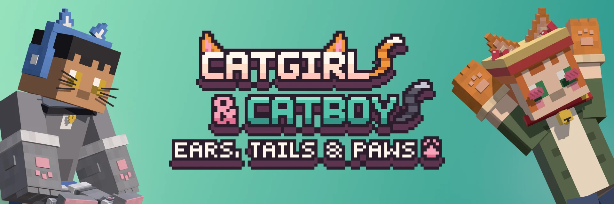

  
  
  
  
  

  <b>Cat ears, tails and paws that you wear over your armor. 
  Also a meow key, catnip, a cardboard box to hide in, and cat folk living in your villages.</b>

  <a href="#wear-it">Wear it</a> ·
  <a href="#sets">Sets</a> ·
  <a href="#meow">Meow</a> ·
  <a href="#cat-life">Cat life</a> ·
  <a href="#snacks">Snacks</a> ·
  <a href="#nekos">Nekos</a> ·
  <a href="#install">Install</a> ·
  <a href="#faq">FAQ</a>

---

Craft a pair of cat ears from wool, string and leather, put them on, done. There's no potion to drink and no
transformation to sit through. Everything in this mod goes into eight cosmetic slots next to your inventory, sits on
top of whatever armor you have on, and shows up for everyone on the server.

Catgirl or catboy is up to you. Every piece fits slim and classic skins the same way, and no item cares who wears it.

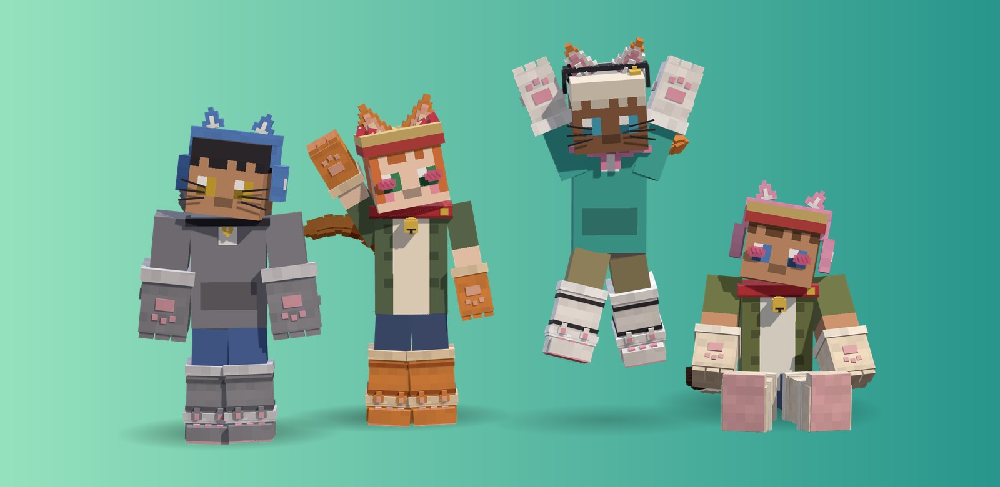

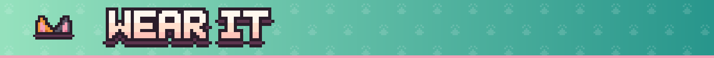

## Wear it

| Slot | What goes there |
|---|---|
| Ears | cat ears |
| Head | cat-ear headphones · ear bows · bell headband |
| Face | whiskers · blush |
| Neck | bell collar · velvet choker · neck ribbon |
| Paws | paw gloves · paw mittens |
| Legs | paw leg warmers |
| Feet | paw slippers |
| Tail | cat tail |

The fur pieces (ears, tail, paws, leg warmers, slippers) come in **8 coats**. Six of them you craft, and the wool
picks the coat: black, white, gray and pink wool give those colors, orange gives ginger, lime gives neon. Siamese and
calico can't be crafted; you get them from the nekos (see below).
Collars, ribbons, bows, headphones, whiskers and blush take any dye, the same way leather armor does.

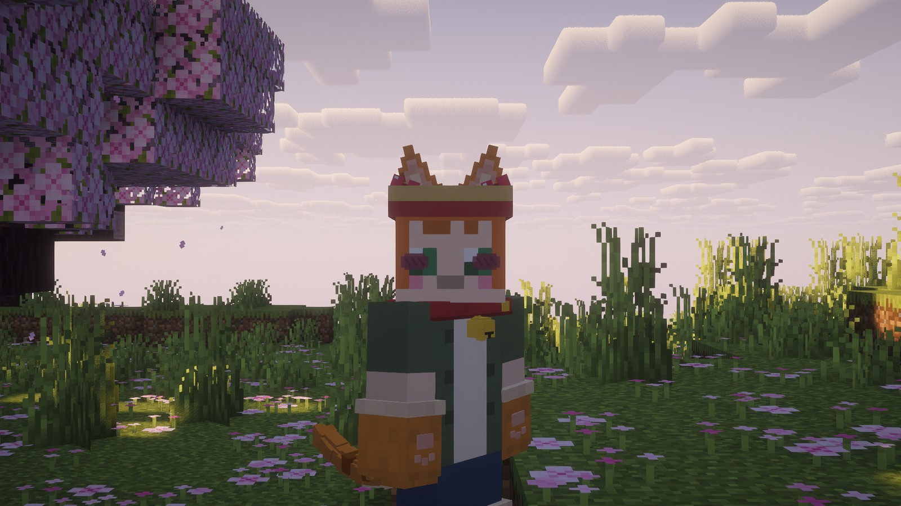 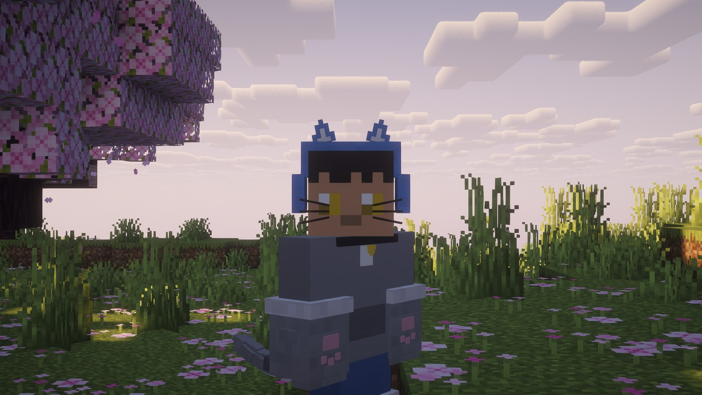

Ears twitch now and then, press back when you get hurt and pop up over a helmet. The tail sways when you stand and
lifts when you walk. A bell on your collar or headband rings when you jump, and paw slippers make your steps a
little quieter even without a set. Cat-ear headphones have ears of their own,
so they hide the separate ears while you wear both.

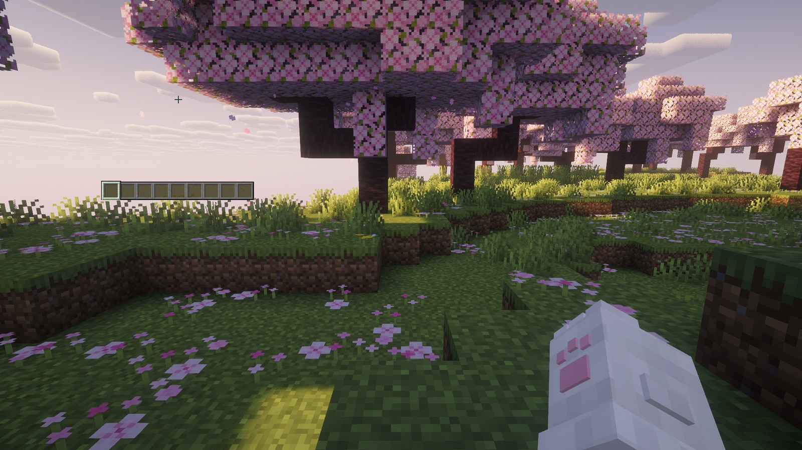 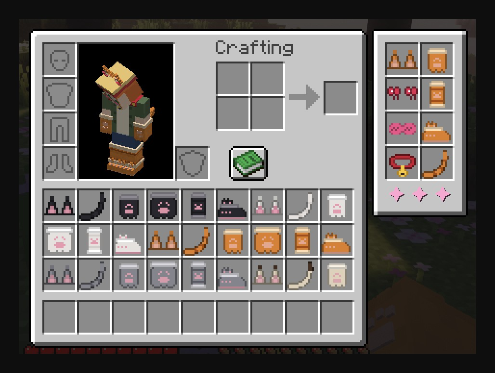

Paws show in first person too. To put something on, drop it in its slot, shift-click it, or right-click with it in
your hand.

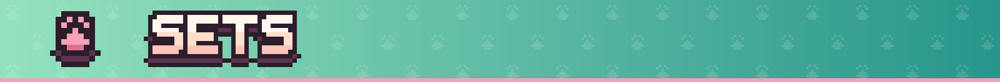

## Sets

Wear the right pieces together and you get a small bonus. Pieces show which set they belong to in their tooltip.

| Set | Pieces | What you get |
|---|---|---|
| **Full Neko** | ears, tail, collar, paws | quieter steps, a slightly higher jump, hearts when you meow, and cat eyes: night vision for 10 seconds on **N**, then 30 seconds to recharge |
| **House Cat** | ears, collar | cats nearby don't run off and follow you around; a cat within 16 blocks counts as rest, so phantoms leave you alone |
| **Alley Cat** | tail, slippers, leg warmers | no fall damage from up to 10 blocks, and you land on all fours |

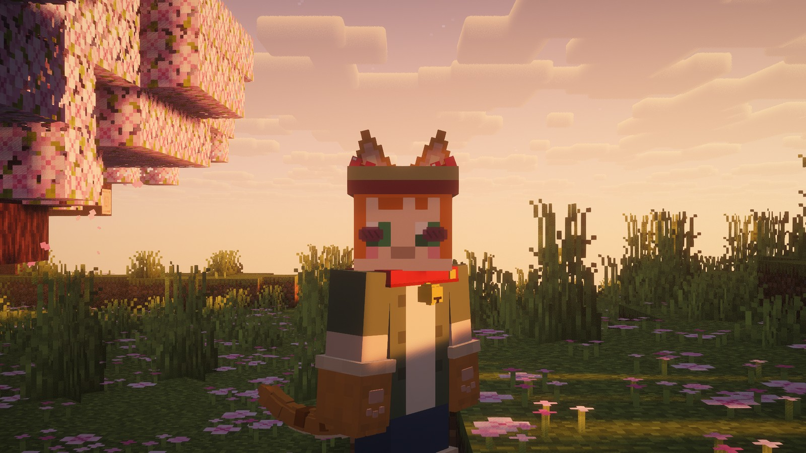

## Meow

Press **Z**. You meow, a few notes float up, and the cats around you answer one by one. That's the whole feature, and
it's the one you'll press the most.

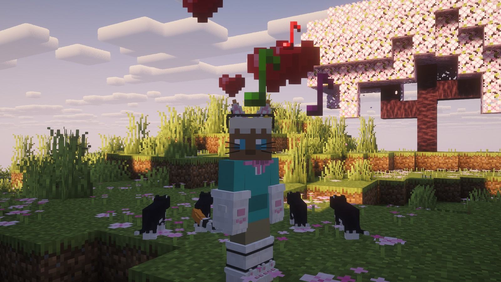

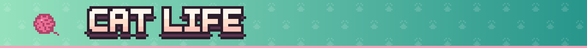

## Cat life

- **Cardboard box.** Climb in with right-click and mobs lose track of you. Sneak to get out.
- **Cat bed.** Curl up in it day or night. Your food comes back a little at a time, and after a full nap you get
  *Well Rested*: 15% more speed for a minute. It counts as sleep for phantoms.
- **Catnip.** Grows wild in plains, meadows, forests and cherry groves; bone meal speeds it up. Eating it gives you
  Haste and a wobbly high, and every cat nearby gets the zoomies.
- **Yarn ball.** Throw it and watch cats chase it and bat it around.

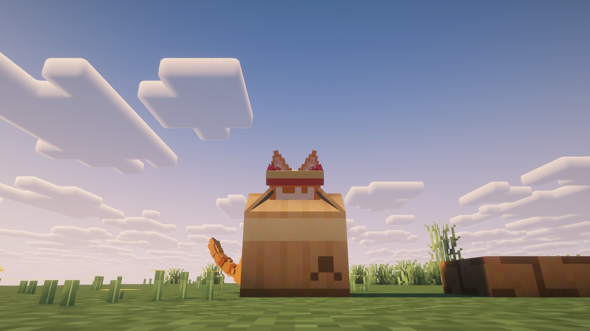 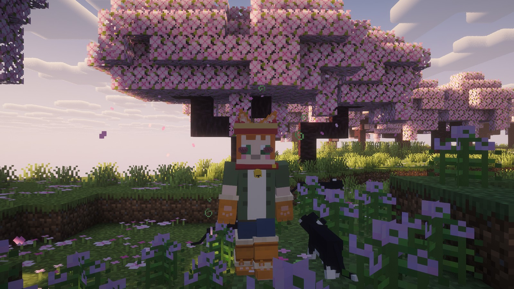

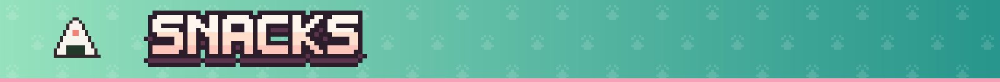

## Snacks

| Food | Made from | Does |
|---|---|---|
| Tuna Onigiri | cooked fish, wheat, dried kelp | 6 food |
| Fish Sticks | cod and wheat (makes 4), then cooked | 4 food, eaten quickly |
| Saucer of Milk | a milk bucket and three bowls (makes 3) | clears bad effects, keeps the good ones |
| Cat Food | raw fish, bone, wheat | 8 food while you wear a set, 2 without; cats can be tamed with it |
| Catnip Cookie | catnip, wheat, sugar (makes 4) | Haste and Jump Boost for 20 seconds |
| Takoyaki | squid tentacle and wheat | 7 food and 5 seconds of Regeneration |
| Milk Bubble Tea | milk bucket, sugar, sweet berries, a bottle | 4 food, clears Mining Fatigue |
| Can of Tuna | four raw fish and an iron ingot (makes 4) | 5 food, stacks to 64 |

Squids and glow squids drop the tentacles.

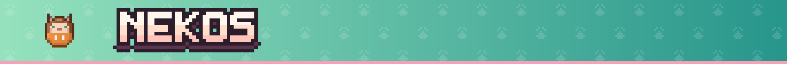

## Nekos

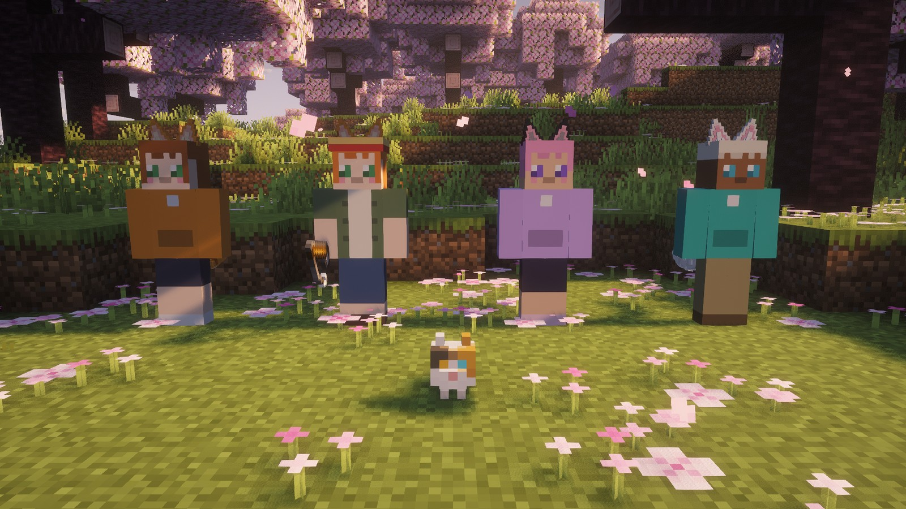

- **Stray Neko** lives in villages and trades ears, tails, collars and fish for emeralds, sometimes a tail in a rare
  coat. Feed it raw fish and it may start following you, napping on your cat beds and bringing kittens.
- **Kitten** plays with yarn and boxes and grows up into a Stray Neko that keeps its coat and its owner.
- **Fisher Neko** sits by beaches and rivers with a rod. Every 10 raw fish you bring buys a random fur piece in
  Siamese or Calico.
- **Bakeneko** comes out at night in dark forests and snatches whatever you're holding, unless you're dressed in Full
  Neko. Then catnip buys your stuff back.
- **Cat Spirit** shows up on quiet nights. Give it a small flower and you get *Nine Lives* until the next day: the
  next time you die, you don't.

Advancements to chase: *First Meow*, *Herding Cats*, *Full Neko*, *Nine Lives*, *Box Enjoyer*, *Catnip Overdose*.

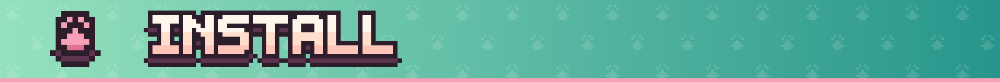

## Install

1. Minecraft **26.3** with **Fabric** (plus Fabric API) or **NeoForge**.
2. Also needed: [Architectury API](https://modrinth.com/mod/architectury-api) and [GeckoLib](https://modrinth.com/mod/geckolib).
3. Put the mod on both the client and the server.

Works with **JEI** (info pages for every item, coats as separate entries), **Jade**, and **Curios** on NeoForge.

## FAQ

**Do I need it on the server?** Yes. Ears and tails sync between players, so both sides need the mod.

**Can I turn into a neko?** No, and that's on purpose. You're a player who wears cat stuff. Take it off and you're
back to normal.

**Does armor hide my ears?** No. Cosmetics sit on top of armor and never replace it. A visible helmet hides
the head pieces (headphones, bows, headband), and the ears poke out above it.

**Can a modpack change things?** Recipes are plain JSON, and the item tags (`#catgirl:ears`, `#catgirl:tails` and
the rest) decide what counts for each set.

**Older Minecraft versions?** 1.21.1 and 1.20.1 are planned.

---

  MIT license · made by <a href="https://github.com/eliasnvx">eliasnvx</a>, who also made Femboy Mod 
  Sounds and their sources: <a href="CREDITS.md">CREDITS.md</a>

